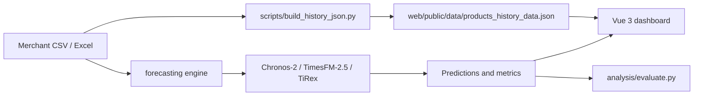

# Entity Merchant Sales Forecasting Platform

A sanitized, runnable demo of an end-to-end sales forecasting platform for physical merchants:
a Vue 3 business dashboard plus a Python zero-shot time-series forecasting engine.

[](LICENSE)
[](https://github.com/zhangxinqi2/-entity-merchant-sales-forecasting/actions/workflows/ci.yml)
[](https://www.python.org/)
[](https://vuejs.org/)
[](https://vitejs.dev/)

[中文文档](README.md) · [Quick start](#quick-start) · [Data format](docs/data-format.md) · [Contributing](CONTRIBUTING.md)

## What is included

- **Dashboard** — industry overview, product sales distribution, holiday effects, heatmaps.
- **Data management** — demo forms for adding stores/products and viewing or editing CSV rows.
- **Inventory forecasting** — future sales predictions, confidence bands, and replenishment suggestions.
- **Model comparison** — Chronos-2, TimesFM-2.5, TiRex, plus XGBoost, CatBoost, SARIMA, LSTM, PatchTST baselines.
- **Python forecasting engine** — `UnifiedForecaster`, CLI, examples, evaluation and plotting utilities.
- **Evaluation** — WMAPE, MAPE, SMAPE, MAE, RMSE.

> **Data notice**
>
> This repository contains **no real merchant data, addresses, sales records, competition data, or submission documents**.
> All demo data in `data/sample/`, `web/src/data/`, and `web/public/data/` is generated by
> [`scripts/generate_sample_data.py`](scripts/generate_sample_data.py). See [data/README.md](data/README.md).

## Quick start

### Web dashboard

```bash
git clone https://github.com/zhangxinqi2/-entity-merchant-sales-forecasting.git
cd entity-merchant-sales-forecasting/web
npm install
npm run dev
```

Open <http://localhost:5174>. The router uses hash history, so the build works on static hosting
without server rewrites.

```bash
npm run build
VITE_BASE=/entity-merchant-sales-forecasting/ npm run build   # GitHub Pages
```

### Python forecasting engine

```bash
cd forecasting
python -m venv .venv
# Windows: .venv\Scripts\activate
# macOS/Linux: source .venv/bin/activate
pip install -r requirements.txt
pip install -e .
python examples/01_basic_forecasting.py
```

Download the pretrained weights (not stored in this repository):

```bash
python scripts/download_models.py --list
python scripts/download_models.py --model all
```

### Evaluate predictions

```bash
python analysis/evaluate.py --self-test
python analysis/evaluate.py --input predictions.csv
```

## Repository layout

```text
web/            Vue 3 dashboard (Vite, Tailwind, ECharts)
forecasting/    Python forecasting engine (src layout)
analysis/       Reusable evaluation script
scripts/        Synthetic data generator, CSV-to-JSON converter, model downloader
data/sample/    Synthetic sample CSVs
docs/           Architecture, data format, deployment, FAQ, publishing guide
```

## Data flow



## Models

| Model | Publisher | Type |
|-------|-----------|------|
| Chronos-2 | Amazon | Zero-shot foundation model |
| TimesFM-2.5 | Google | Zero-shot foundation model |
| TiRex | NX-AI | Zero-shot foundation model |
| XGBoost / XGBoost+RF | DMLC / ensemble | Tree models |
| CatBoost | Yandex | Tree model |
| SARIMA | Statistics | Classical baseline |
| LSTM | Academia | Deep learning baseline |
| PatchTST | Academia | Transformer baseline |

The comparison numbers shown in the web app are aggregate results from the author's original
competition experiments. They contain no merchant-level records and are for demonstration only.

## License

Code is licensed under the [Apache License 2.0](LICENSE).
Third-party model and dependency licenses are listed in [THIRD_PARTY_NOTICES.md](THIRD_PARTY_NOTICES.md).
The **TiRex model weights** are distributed under the NXAI Community License Agreement, not Apache-2.0.

## Disclaimer

This is a technical demo and learning project, not business, investment, or operational advice.
Forecast accuracy depends on data quality and model assumptions. When using real data, make sure you
have the necessary authorization and comply with applicable privacy and data-protection laws.
