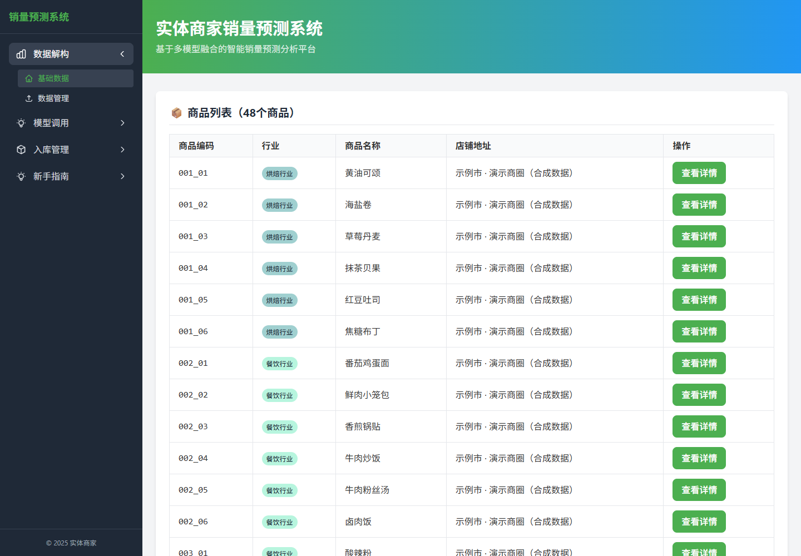
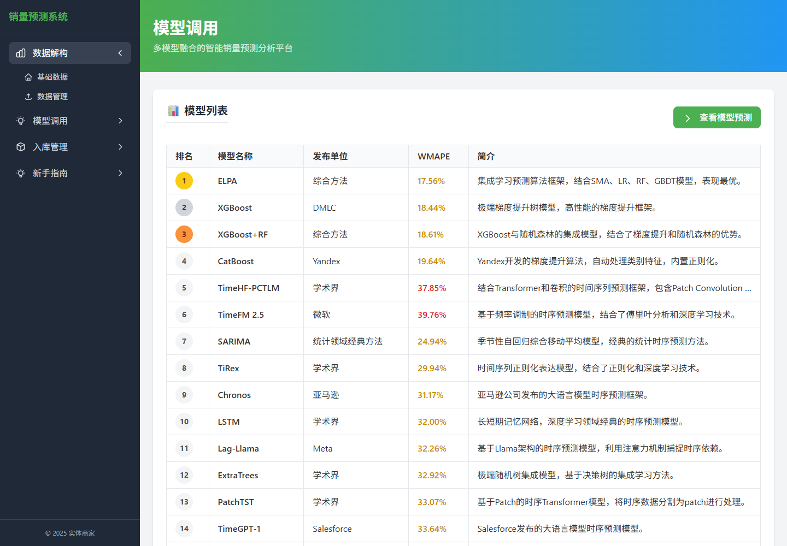
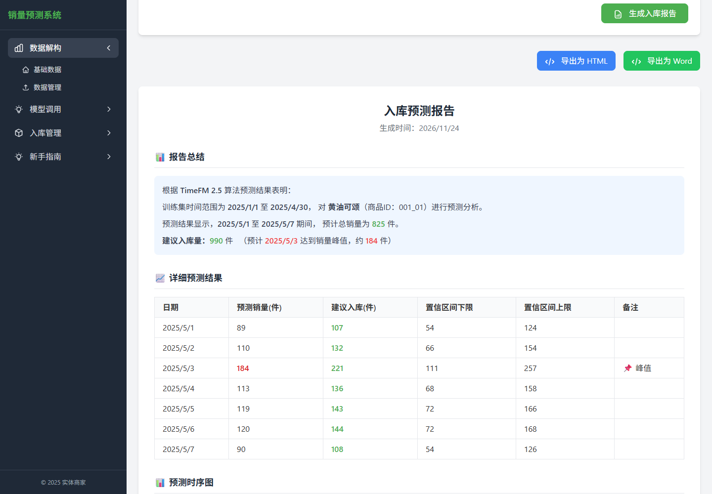
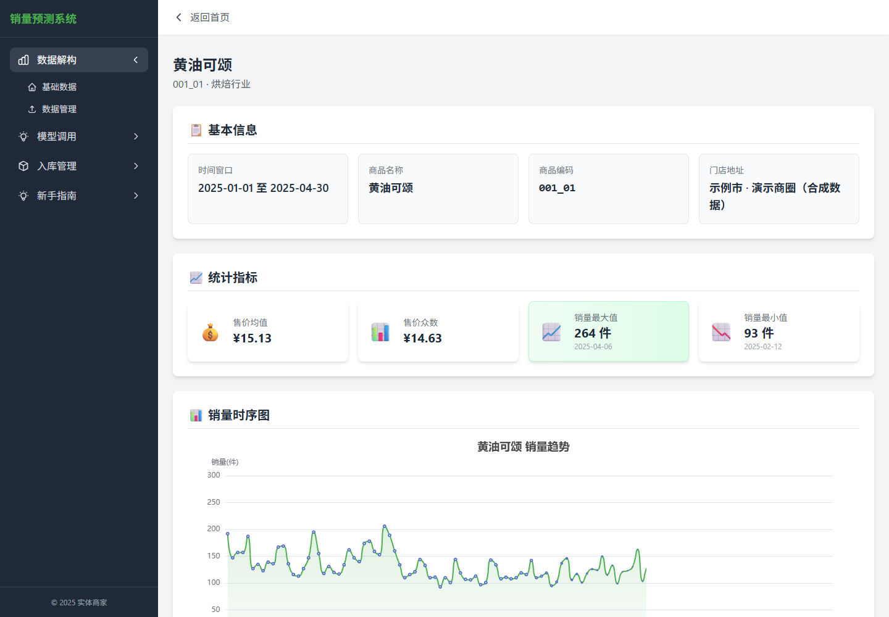
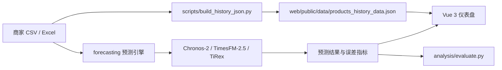

<div align="center">


# 实体商家销量预测系统

**Entity Merchant Sales Forecasting Platform**

一个面向实体商家的「销量预测 + 经营决策」演示平台：Vue 3 经营仪表盘 + Python 零样本时间序列预测引擎。

[](LICENSE)
[](https://github.com/zhangxinqi2/-entity-merchant-sales-forecasting/actions/workflows/ci.yml)
[](https://www.python.org/)
[](https://vuejs.org/)
[](https://vitejs.dev/)
[](https://zhangxinqi2.github.io/-entity-merchant-sales-forecasting/)
[](CONTRIBUTING.md)
[](https://github.com/zhangxinqi2/-entity-merchant-sales-forecasting/stargazers)

[快速开始](#快速开始) · [界面预览](#界面预览) · [项目结构](#项目结构) · [数据格式](docs/data-format.md) · [参与贡献](CONTRIBUTING.md)

</div>

---

## 项目简介

本仓库是一个**已脱敏、可公开运行**的实体商家销量预测项目，包含：

- **经营仪表盘**：行业概览、商品销量分布、节假日效应、热力图；
- **数据管理**：新店家录入、商品编号、数据表格查看与编辑（前端演示）；
- **库存与补货**：基于历史销量生成未来 N 天预测和补货建议；
- **模型调用与对比**：Chronos-2、TimesFM-2.5、TiRex 等预训练模型，以及 XGBoost、CatBoost、SARIMA、LSTM、PatchTST 等基线模型的对比展示；
- **商品与模型详情**：商品历史销量、预测曲线、误差指标；
- **Python 预测引擎**：统一的 `UnifiedForecaster` 接口、CLI、评估与可视化工具；
- **评测脚本**：WMAPE、MAPE、SMAPE、MAE、RMSE 的通用实现。

> **数据声明**
>
> 仓库**不包含任何真实商家数据、门店地址、比赛数据、参赛承诺书或申报材料**。
> `data/sample/`、`web/src/data/`、`web/public/data/` 中的全部数据均由
> [`scripts/generate_sample_data.py`](scripts/generate_sample_data.py) 合成，仅用于演示。
> 详见 [数据说明](data/README.md)。

本项目的预测引擎同时维护在独立仓库：
[Maicarons/Time-Series-Forecasting-Zero](https://github.com/Maicarons/Time-Series-Forecasting-Zero)。

## 功能特性

| 模块 | 说明 |
|------|------|
| 经营总览 | 三个行业的商品数、销量分布、节假日与打折对比、热力图入口 |
| 数据管理 | 新店家信息录入、按行业自动生成商品编号、表格查看与编辑（演示，不落库） |
| 入库管理 / 库存预测 | 选择商品和模型，生成未来 7/14/30 天销量预测、置信区间与补货建议 |
| 模型调用 | 模型排行榜、滚动窗口回测结果、模型简介 |
| 模型详情 | 测试集预测值与真实值对比、误差指标、预测明细 |
| 商品详情 | 历史销量、价格、气温、节假日、打折记录与统计信息 |
| 使用指南 | 平台各模块的操作说明 |
| 预测引擎 | Chronos-2 / TimesFM-2.5 / TiRex 统一接口、批量预测、模型对比、CLI |
| 评测工具 | WMAPE / MAPE / SMAPE / MAE / RMSE，支持 CSV 输入和 JSON 输出 |

## 技术栈

**前端**

- Vue 3 + Vue Router + Pinia
- Vite 5
- Tailwind CSS 3
- ECharts 5 + vue-echarts

**预测引擎**

- Python 3.9+
- PyTorch 2.x
- Chronos-2（Amazon）、TimesFM-2.5（Google）、TiRex（NX-AI）
- pandas / NumPy / scikit-learn / matplotlib / loguru

**工程化**

- GitHub Actions：Python 编译检查 + 前端构建 + GitHub Pages 部署
- Dependabot：npm / pip / GitHub Actions 依赖更新
- Apache-2.0 许可证

## 界面预览

> 以下截图使用仓库内的合成示例数据生成，不含真实商家信息。

| 商品列表 / 经营总览 | 模型调用 |
|:---:|:---:|
|  |  |

| 入库管理 / 库存预测 | 商品详情 |
|:---:|:---:|
|  |  |

## 快速开始

### 方式一：运行 Web 仪表盘（推荐）

```bash
git clone https://github.com/zhangxinqi2/-entity-merchant-sales-forecasting.git
cd entity-merchant-sales-forecasting/web

npm install
npm run dev
```

打开 <http://localhost:5174>。路由使用 hash 模式，因此静态托管时无需服务端重写规则。

生产构建：

```bash
npm run build
npm run preview
```

构建产物在 `web/dist/`。部署到 GitHub Pages 时设置：

```bash
VITE_BASE=/entity-merchant-sales-forecasting/ npm run build
```

仓库已包含 [Pages 工作流](.github/workflows/pages.yml)，在 GitHub 仓库设置中把
**Settings → Pages → Source** 设为 **GitHub Actions** 即可自动部署。

### 方式二：运行 Python 预测引擎

```bash
cd forecasting

# 建议使用虚拟环境
python -m venv .venv
# Windows: .venv\Scripts\activate
# macOS/Linux: source .venv/bin/activate

pip install -r requirements.txt
pip install -e .

# 运行基础示例
python examples/01_basic_forecasting.py
```

模型权重不随仓库分发，请先下载：

```bash
# 安装下载客户端（二选一）
pip install modelscope          # 默认从 ModelScope 下载
# pip install huggingface_hub   # 或从 Hugging Face 下载

# 回到仓库根目录
python scripts/download_models.py --list
python scripts/download_models.py --model all
```

也可以从 ModelScope / Hugging Face 手动下载，放到：

```text
forecasting/models/chronos-2/
forecasting/models/timesfm-2.5-200m-pytorch/
forecasting/models/tirex-model/
```

更多用法见 [`forecasting/README_zh.md`](forecasting/README_zh.md)。

### 方式三：评测自己的预测结果

```bash
python analysis/evaluate.py --self-test
python analysis/evaluate.py --input predictions.csv
```

`predictions.csv` 需要包含 `actual` 和 `predicted` 两列：

```csv
date,actual,predicted
2025-01-01,120,117
2025-01-02,131,128
```

## 项目结构

```text
entity-merchant-sales-forecasting/
├── web/                          # Vue 3 经营仪表盘
│   ├── src/
│   │   ├── views/                # 总览、数据管理、库存、模型、商品、指南
│   │   ├── data/                 # 合成演示数据（自动生成）
│   │   └── router/
│   ├── public/
│   │   ├── data/                 # 商品历史 JSON（合成）
│   │   └── images/boxplots/      # 行业箱线图（合成）
│   └── package.json
├── forecasting/                  # Python 预测引擎（src layout）
│   ├── src/time_series_forecasting_zero/
│   │   ├── models/               # Chronos-2 / TimesFM / TiRex / 统一接口
│   │   ├── data/                 # 数据加载与预处理
│   │   ├── utils/                # 评估、可视化、日志
│   │   └── cli.py                # tsforecast 命令
│   ├── examples/                 # 示例脚本
│   ├── tests/                    # 单元与集成测试
│   └── models/                   # 模型权重（不提交，见 README）
├── analysis/                     # 通用评测脚本
├── scripts/                      # 数据生成、JSON 转换、模型下载
├── data/
│   ├── sample/                   # 合成示例 CSV
│   └── raw/                      # 你自己的数据（被 gitignore）
├── docs/                         # 架构、数据格式、部署、FAQ、发布指南
├── .github/                      # CI、Pages、Issue/PR 模板、Dependabot
├── LICENSE                       # Apache-2.0
└── README.md
```

## 支持的模型

| 模型 | 发布方 | 类型 | 说明 |
|------|--------|------|------|
| Chronos-2 | Amazon | 零样本基础模型 | 通用场景，稳健性能 |
| TimesFM-2.5 | Google | 零样本基础模型 | 长序列，高精度 |
| TiRex | NX-AI | 零样本基础模型 | 轻量、快速推理 |
| XGBoost / XGBoost+RF | DMLC / 集成 | 树模型 | 强基线，适合表格特征 |
| CatBoost | Yandex | 树模型 | 自动处理类别特征 |
| SARIMA | 统计领域 | 经典时序 | 可解释的统计基线 |
| LSTM | 学术界 | 深度学习 | 序列建模基线 |
| PatchTST | 学术界 | Transformer | Patch 化时序建模 |
| ELPA | 本项目 | 集成方法 | SMA + LR + RF + GBDT 集成 |

> Web 中的模型对比指标来自作者在原比赛数据上的**聚合评测结果**，不含任何商家级明细。
> 这些数字用于展示平台功能，不构成对任何模型在其它数据集上表现的保证。
> 模型权重许可证见 [THIRD_PARTY_NOTICES.md](THIRD_PARTY_NOTICES.md)。

## 数据流



- 演示数据由 `scripts/generate_sample_data.py` 生成；
- 真实数据只应放在 `data/raw/`，该目录默认被 `.gitignore` 忽略；
- 前端不连接数据库，所有演示数据均为静态 JSON/JS，便于直接部署到 GitHub Pages。

## 文档

- [架构说明](docs/architecture.md)
- [数据格式](docs/data-format.md)
- [部署指南](docs/deployment.md)
- [常见问题](docs/faq.md)
- [维护者发布指南](docs/PUBLISHING.md)
- [贡献指南](CONTRIBUTING.md)
- [安全策略](SECURITY.md)
- [第三方许可证](THIRD_PARTY_NOTICES.md)

## 路线图

- [x] Vue 3 经营仪表盘与合成演示数据
- [x] Chronos-2 / TimesFM-2.5 / TiRex 统一预测接口
- [x] WMAPE / MAPE / SMAPE / MAE / RMSE 评测工具
- [x] GitHub Actions CI 与 GitHub Pages 部署
- [ ] 增加 FastAPI 后端，支持真实数据导入与在线预测
- [ ] 增加模型微调与超参数搜索示例
- [ ] 增加 Docker Compose 一键启动
- [ ] 增加英文文档与更多行业示例

## 贡献

欢迎提交 Issue 和 Pull Request。开始之前请阅读：

1. [CONTRIBUTING.md](CONTRIBUTING.md)
2. [CODE_OF_CONDUCT.md](CODE_OF_CONDUCT.md)
3. [SECURITY.md](SECURITY.md)

**数据隐私红线**：任何包含真实商家名称、地址、销量、订单、手机号、比赛数据或申报材料的文件都不得提交到本仓库。

## 许可证

本项目代码使用 [Apache License 2.0](LICENSE)。

第三方模型、数据集和前端依赖的许可证见 [THIRD_PARTY_NOTICES.md](THIRD_PARTY_NOTICES.md)。
其中 **TiRex 模型权重**使用 NXAI Community License Agreement，不等同于 Apache-2.0；下载和使用前请阅读其许可证。

## 致谢

- [Chronos-2](https://github.com/amazon-science/chronos-forecasting) — Amazon
- [TimesFM](https://github.com/google-research/timesfm) — Google Research
- [TiRex](https://github.com/NX-AI/tirex) — NX-AI
- [Vue.js](https://vuejs.org/)、[Vite](https://vitejs.dev/)、[ECharts](https://echarts.apache.org/)、[Tailwind CSS](https://tailwindcss.com/)
- 所有为本项目提供建议、数据和反馈的老师、同学与商家

## 免责声明

本项目是技术演示与学习项目，不构成任何商业、投资或经营建议。预测结果受数据质量、模型假设和市场变化影响，实际经营决策请结合人工判断。使用真实数据时，请确保你拥有合法授权，并遵守相关隐私和数据保护法规。

---

<div align="center">

**如果这个项目对你有帮助，欢迎点一个 ⭐ Star。**

[回到顶部](#实体商家销量预测系统)

</div>
