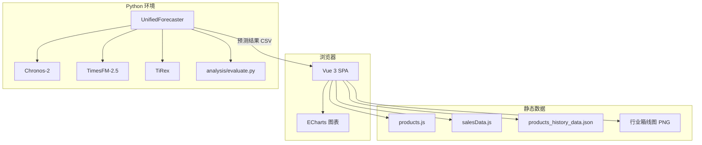

# 架构说明 / Architecture

## 总览

项目由三个相对独立的部分组成：

1. **Web 仪表盘**（`web/`）：Vue 3 单页应用，读取静态 JSON/JS 演示数据，负责可视化和交互。
2. **预测引擎**（`forecasting/`）：Python 包，统一封装 Chronos-2、TimesFM-2.5、TiRex，支持脚本、CLI 和库调用。
3. **数据与评测工具**（`scripts/`、`analysis/`）：生成合成数据、转换 CSV、下载模型、计算误差指标。



## 前端

### 页面

| 路由 | 页面 | 数据来源 |
|------|------|----------|
| `/` | 经营总览 | `products.js`、`salesData.js`、箱线图 |
| `/product/:productId` | 商品详情 | `products_history_data.json` |
| `/data-management` | 数据管理 | 本地表单 / 文件选择（演示，不落库） |
| `/model-calling` | 模型调用 | `models.js` |
| `/model-detail` | 模型详情 | `salesData.js` 的 `generateFullPredictionData` |
| `/inventory` | 入库管理 / 库存预测 | `products_history_data.json` + 模型误差 |
| `/guide` | 使用指南 | 静态内容 |

### 设计选择

- **Hash 路由**：静态托管（GitHub Pages）无需服务端 404 重写。
- **无后端**：演示数据以 JS/JSON 形式随构建产物发布，克隆即可运行。
- **合成数据**：仓库不包含真实商家数据；演示数据由脚本生成。
- **绝对路径使用 `import.meta.env.BASE_URL`**：兼容 GitHub Pages 子路径部署。

### 目录

```text
web/src/
├── components/       # 侧边栏等通用组件
├── data/             # products.js、salesData.js、models.js（后两者部分自动生成）
├── router/           # 路由表（hash history）
├── views/            # 各页面
├── App.vue
├── main.js
└── style.css
```

## 预测引擎

`forecasting/` 采用 `src` layout，安装后包名为 `time_series_forecasting_zero`。

```text
forecasting/src/time_series_forecasting_zero/
├── models/
│   ├── base.py       # 模型基类
│   ├── unified.py    # 统一接口 UnifiedForecaster
│   ├── chronos2.py   # Chronos-2 适配
│   ├── timesfm.py    # TimesFM-2.5 适配
│   └── tirex.py      # TiRex 适配
├── data/             # CSV 加载与预处理
├── configs/          # 配置对象与 INI 读取
├── utils/            # 指标、可视化、日志
└── cli.py            # tsforecast 命令
```

### 统一接口

所有模型返回同一种字典：

```python
{
    "mean": np.ndarray,              # 点预测
    "quantiles": {0.1: ..., 0.5: ..., 0.9: ...},
    "lower_bound": np.ndarray,       # 预测区间下界
    "upper_bound": np.ndarray,       # 预测区间上界
}
```

这样前端、评估脚本和模型对比逻辑不需要关心具体模型实现。

### 模型权重

权重不进入 Git。`scripts/download_models.py` 从 ModelScope/Hugging Face 下载到
`forecasting/models/`。模型路径优先级：

1. 命令行参数 / 函数参数；
2. INI 配置；
3. 环境变量；
4. 默认的 `./models/...` 路径。

## 数据流

### 演示数据

```text
scripts/generate_sample_data.py
        │
        ├── web/src/data/products.js
        ├── web/src/data/salesData.js
        ├── web/public/data/products_history_data.json
        ├── web/public/images/boxplots/*.png
        └── data/sample/*.csv
```

### 真实数据（本地，不提交）

```text
data/raw/*.csv
        │
        └── scripts/build_history_json.py
                    │
                    └── web/public/data/products_history_data.json
```

### 预测

```text
data/sample/*.csv
        │
        └── forecasting (UnifiedForecaster)
                    │
                    ├── predictions.csv
                    └── analysis/evaluate.py → WMAPE / MAPE / SMAPE / MAE / RMSE
```

## 扩展为带后端的系统

当前前端是静态演示。若要接入真实业务，推荐：

1. 增加 FastAPI 服务：负责数据入库、模型推理、预测结果缓存；
2. 前端把 `fetch('/data/...')` 换成 API 调用；
3. 数据层使用 PostgreSQL / DuckDB；
4. 用对象存储保存模型权重和大型预测结果；
5. 增加鉴权和租户隔离，避免不同商家数据混用。

保持当前的 `UnifiedForecaster` 接口不变，后端只需新增数据层和 API 层。

## 安全与隐私

- 真实数据只放在 `data/raw/`，该目录被 `.gitignore` 忽略；
- 仓库不包含模型权重、虚拟环境、`node_modules`、比赛材料和申报材料；
- 发布前请按 [PUBLISHING.md](PUBLISHING.md) 的检查清单复核。
